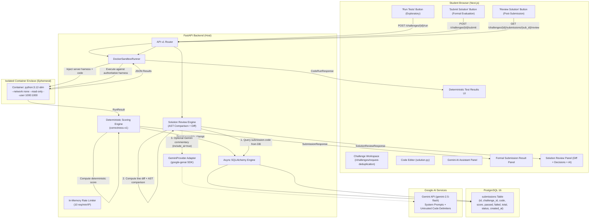

# AI Coding Interview Gym — Architecture Specification

## 1. Executive Overview

AI Coding Interview Gym is a specialized training platform designed to prepare software engineering candidates for modern, AI-assisted technical interviews. Unlike legacy platforms focusing primarily on algorithmic puzzles from scratch, this platform simulates realistic engineering rounds: debugging pre-existing production code, collaborating with AI assistants under controlled permissions, and receiving evidence-based scoring on both technical execution and AI interaction.

This document covers:
- **Phase 1**: Monorepo MVP Foundation (FastAPI, Next.js, PostgreSQL config).
- **Phase 2**: Deterministic Challenge Execution in an Isolated Docker Sandbox.
- **Phase 3**: Backend-Only Google Gemini AI Assistant Integration ("Explain This Code" & "Give Me a Hint").
- **Phase 4.1**: Submission Flow, Deterministic Correctness Scoring (`correctness-v1`), and PostgreSQL Persistence.
- **Phase 4.2**: Post-Submission Solution Review, AST Difference Analysis, Architectural Decisions, and Gemini Commentary.

---

## 2. System Architecture

The platform is organized as a lightweight monorepo cleanly separating client interface, core REST API, Docker test execution, scoring engine, review analysis service, database models, and AI model adapters.

```
ai-coding-gym/
├── apps/
│   ├── web/                     # Next.js App Router (TypeScript Strict, Tailwind CSS)
│   │   ├── app/
│   │   │   ├── challenges/      # Interactive challenge workspace (/challenges/request-deduplication)
│   │   │   └── page.tsx         # Platform landing & feature overview
│   │   └── components/          # Reusable UI (CodeEditor, TestResults, SubmissionResultPanel, SolutionReviewPanel, AiAssistantPanel)
│   └── api/                     # Python 3.12 + FastAPI REST Service
│       ├── alembic/             # Alembic database migrations (submissions table)
│       ├── app/
│       │   ├── api/v1/          # Endpoints (/health, /challenges, /challenges/.../submit, /challenges/.../review, /challenges/.../ai)
│       │   ├── core/            # Configuration, logging, database engine & session provider, rate limiter
│       │   ├── models/          # SQLAlchemy 2.x models (Submission)
│       │   ├── schemas/         # Pydantic v2 validation models (health, challenge, submission, review, ai)
│       │   └── services/
│       │       ├── challenges/  # Challenge definitions, test harnesses, and solution_review service
│       │       ├── runner/      # Docker containerized execution sandbox
│       │       ├── scoring/     # Deterministic correctness scoring service (correctness-v1)
│       │       └── ai/          # Google Gemini provider adapter & system prompts
│       └── tests/               # Pytest automated test suite (53 tests)
├── infra/
│   └── docker-compose.yml       # Local PostgreSQL 16 container definition
├── docs/
│   └── architecture.md          # Architectural specification (this file)
├── .env.example                 # Safe development environment template
├── .gitignore                   # Monorepo git ignore rules
└── README.md                    # Setup and operational instructions
```

### Component Breakdown

| Component | Technology | Role | Status |
| :--- | :--- | :--- | :--- |
| **Frontend Web** | Next.js (App Router), TypeScript (Strict), Tailwind CSS | Student interface, challenge workspace, custom code editor, submission & test results panels, solution review panel, AI panel | **Implemented (Phase 1, 2, 3, 4.1, 4.2)** |
| **API Backend** | Python 3.12, FastAPI, Pydantic v2, Uvicorn | REST API, health probes, challenge metadata, runner orchestration, scoring, review engine, submission persistence | **Implemented (Phase 1, 2, 3, 4.1, 4.2)** |
| **Isolated Sandbox Runner** | Docker ephemeral containers, `python:3.12-slim` | Safe execution of student code with resource & network isolation | **Implemented (Phase 2)** |
| **Deterministic Scoring Service** | Python service (`app.services.scoring.service`) | Formulaic grading: `round(passed / total * 100)`, rubric `correctness-v1`, error differentiation | **Implemented (Phase 4.1)** |
| **Solution Review Service** | Python service (`app.services.challenges.solution_review`) | Line diff, AST semantic analysis, 4 key decisions, takeaways, optional Gemini comparison | **Implemented (Phase 4.2)** |
| **Database Persistence** | PostgreSQL 16, SQLAlchemy 2.x, Alembic | Persistent storage of scorable candidate submissions in `submissions` table | **Implemented (Phase 4.1)** |
| **AI Provider Adapter** | Google `google-genai` SDK, `gemini-2.5-flash` | Backend-only AI coaching: "Explain This Code", progressive "Give Me a Hint", post-submission "Review" | **Implemented (Phase 3, 4.2)** |
| **In-Memory Rate Limiter** | Sliding window per client IP | Protects AI endpoints against quota exhaustion in local development | **Implemented (Phase 3)** |

---

## 3. Communication & Data Flow



---

## 4. Phase 4.2: Post-Submission Solution Review Architecture

### 4.1 Solution Access Control & Security Boundaries
- **Post-Submission Enforcement**: The authoritative reference solution (`REFERENCE_SOLUTION`) is strictly held server-side. Pre-submission metadata (`GET /challenges/{id}`) and exploratory execution (`POST /challenges/{id}/run`) never expose the reference solution or test harness.
- **Submission State Verification**: To access the review endpoint, the client must provide a valid `submission_id`. The backend checks:
  1. `challenge_id` matches supported challenges.
  2. `submission_id` exists in the PostgreSQL `submissions` table.
  3. `submission.challenge_id == challenge_id`.
  4. `submission.score is not None` and `submission.status != 'runner_unavailable'`. Submissions resulting from infrastructure errors cannot open the solution review.
- **Source of Truth**: The review uses the code actually stored in PostgreSQL for that submission record, completely ignoring current browser editor changes.
- **Immutability**: Generating a review performs a read-only query. It does not alter the recorded score, test counts, status, or timestamps, and creates no duplicate records.
- **Editor Preservation**: Viewing the reference solution and diff on the frontend does not replace or modify the student's code editor.

### 4.2 Local MVP Limitations vs. Production Requirements
> [!IMPORTANT]
> **Authentication Scope**: The application currently operates as a local, single-user MVP without authentication or student account tables. In this environment, a valid `submission_id` is sufficient to retrieve the review.
>
> **Production Requirements**: In a public multi-tenant deployment, secure access control requires:
> 1. Authenticated user sessions (OAuth 2.0 / JWT).
> 2. Submission ownership verification (`submission.user_id == current_user.id`).
> 3. Role-based permissions (student vs. interviewer vs. admin).
> 4. Server-side audit logging and rate limiting on solution views.

### 4.3 Deterministic Analysis vs. AI Commentary
The review payload cleanly separates deterministic, authoritative insights from probabilistic AI commentary:

1. **Deterministic Components** (Always available, zero AI dependency):
   - **Reference Implementation**: Complete authoritative Python 3.12 implementation.
   - **4 Key Implementation Decisions**:
     * *Fail-Fast Validation*: Explicit `ValueError` on empty/non-string input.
     * *Pre-Mutation Membership Check*: Order of operations (`in seen_ids` before write).
     * *State Mutation*: Registering newly observed IDs via `seen_ids.add`.
     * *Boolean Return Contract*: `True` (first arrival) vs `False` (duplicate).
   - **AST Semantic Analysis & Unified Diff**:
     * Parses Python AST to distinguish exact matches, formatting differences, alternative correct solutions, and functional bugs.
     * Generates standard line-by-line unified diff.
     * Formatting-only differences (comments, docstrings, whitespace) are never falsely flagged as bugs.
   - **Architectural Takeaways**: Idempotency in web APIs, hash table $O(1)$ complexity, and scaling to distributed Redis sets with TTL.
2. **AI-Generated Commentary (Google Gemini)**:
   - Optional, on-demand commentary providing personalized mentorship.
   - Student code is isolated inside `<student_code>` tags to protect against prompt injection.
   - Gemini is **never** permitted to execute code, change scores, or overwrite deterministic test results.
   - If Gemini is disabled, unconfigured, times out, or hits quota limits, the deterministic review remains 100% operational with a clear retry option.

---

## 5. Safe Code Execution Boundary (Docker Sandbox)

> [!CAUTION]
> **Host Execution Ban**: Student-submitted code is **never** executed inside the API process or via host subprocesses. If Docker is absent, execution is refused with clear guidance.

Container isolation flags:
- `--network none`: Network disabled.
- `--user 1000:1000`: Unprivileged non-root user.
- `--read-only`: Immutable filesystem.
- `--tmpfs /tmp:rw,noexec,nosuid,size=16m`: Temporary memory-only filesystem.
- `--cpus 0.5`, `--memory 128m`, `--pids-limit 32`: Resource bounds.
- `--rm`: Ephemeral container lifecycle.

---

## 6. Planned Future Phases (NOT Implemented)

- **User Authentication & Multi-Tenancy**: Student accounts, JWT sessions, submission ownership binding, and interview progress tracking.
- **AI Code Quality & Reasoning Rubric**: LLM evaluation of student problem breakdown, code maintainability, and algorithmic complexity.
- **Curated Multi-Challenge Library**: Additional challenges across data structures, APIs, and algorithms.
